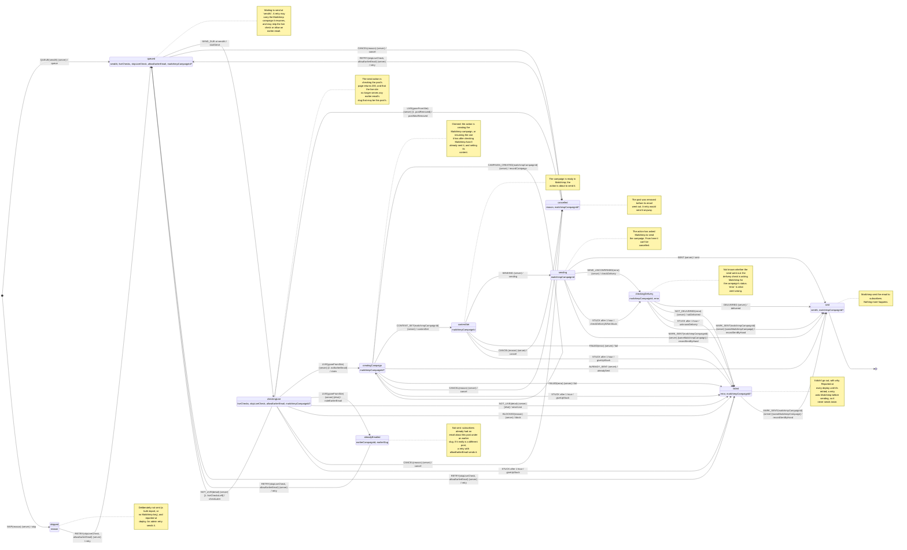

# State machines

Generated from each machine's rules by `bun run machines:diagrams`, and checked by `bun run test` (`convex/machines.test.ts`). Don't edit it by hand. The live version, with the real rows in each state, is the admin Machines page (/admin/machines).

The rules live in `convex/<area>/machine.ts`, and every machine is in the catalog in `convex/machines.ts`. Under each state are its own data fields. `[*] -->` is how a row is born and `--> [*]` marks a final state. Each event says who sends it: `(server)` for internal code, or its timer. The notes and the list under each diagram are the rules' own descriptions.

## `postEmail`, on `postEmailCampaigns.state`

The email to subscribers about a new post: it waits until the post's page is live, then creates, fills and sends one Mailchimp campaign, and ends once, sent or not.

How a row is born:

- `QUEUE(sendAt) (server)` → `queued`. A deploy uploads a new, recent, published post: its email waits 30 minutes for the site to finish deploying.
- `SKIP(reason) (server)` → `skipped`. A new post that mustn't be emailed automatically: the upload run already queued too many (a bulk import), or Mailchimp has no API key.

From `queued`:

- The clock sends `SEND_DUE` at sendAt. It's time to send: the send action starts.
- `SEND_DUE at sendAt` → `checkingLive`. The send action starts by checking the post's page is live.
- `CANCEL(reason) (server)` → `cancelled`. The post was removed (deleted, or renamed to a new slug) before its email went out, so it never will.

From `checkingLive`:

- The clock sends `STUCK` after 1 hour. An hour has passed checking the post is live: the action that runs it crashed or timed out.
- `LIVE(goneFromSite) (server)` [1. postRemoved] → `cancelled`. The post was removed after all (e.g. an admin retry of a renamed post's old slug, whose URL now redirects): it isn't sent, as the post's own campaign is the one that emails about it.
- `LIVE(goneFromSite) (server)` [2. noEarlierEmail] → `creatingCampaign`. The post is live and nothing like it was emailed before: the action creates (or resumes) the Mailchimp campaign.
- `LIVE(goneFromSite) (server)` [else] → `alreadyEmailed`. The post is live, but subscribers were already emailed about it under a slug that's gone: a renamed post, so it isn't sent again.
- `NOT_LIVE(detail) (server)` [1. liveChecksLeft] → `queued`. The page isn't live yet (or the site couldn't say about an earlier slug): check again in 10 minutes.
- `NOT_LIVE(detail) (server)` [else] → `failed`. The page still isn't live after 12 checks over two hours.
- `BLOCKED(reason) (server)` → `failed`. This deployment mustn't email the real list (it isn't production), or Mailchimp has no API key.
- `CANCEL(reason) (server)` → `cancelled`. The post was removed (deleted, or renamed to a new slug) before its email went out, so it never will.
- `STUCK after 1 hour` → `failed`. The action died before claiming it. Nothing reached Mailchimp; safe to retry.

From `creatingCampaign`:

- The clock sends `STUCK` after 1 hour. An hour has passed creating the Mailchimp campaign: the action that runs it crashed or timed out.
- `CAMPAIGN_CREATED(mailchimpCampaignId) (server)` stays put. Mailchimp created the campaign; its ID is kept so a retry resumes it rather than making another.
- `CONTENT_SET(mailchimpCampaignId) (server)` → `contentSet`. The email's HTML (the post's title and link) is set on the campaign.
- `ALREADY_SENT (server)` → `sent`. Resuming a campaign that Mailchimp says already went out (an earlier run died after sending): recorded as sent, not sent again.
- `FAILED(error) (server)` → `failed`. Mailchimp refused or couldn't be reached before anything was sent. Safe to retry.
- `CANCEL(reason) (server)` → `cancelled`. The post was removed (deleted, or renamed to a new slug) before its email went out, so it never will.
- `STUCK after 1 hour` → `failed`. The action died before sending. Safe to retry: it resumes the campaign, if one was made.

From `contentSet`:

- The clock sends `STUCK` after 1 hour. An hour has passed with the campaign ready to send: the action that runs it crashed or timed out.
- `SENDING (server)` → `sending`. The last check before the send: the action asks Mailchimp to send it.
- `FAILED(error) (server)` → `failed`. Something went wrong before the send. Safe to retry.
- `CANCEL(reason) (server)` → `cancelled`. The post was removed (deleted, or renamed to a new slug) before its email went out, so it never will.
- `STUCK after 1 hour` → `failed`. The action died before sending. Safe to retry: it resumes the campaign.

From `sending`:

- The clock sends `STUCK` after 1 hour. An hour has passed since the send was asked for, with no answer: the action that runs it crashed or timed out.
- `SENT (server)` → `sent`. Mailchimp accepted the send: subscribers are getting the email.
- `SEND_UNCONFIRMED(error) (server)` → `checkingDelivery`. The send call failed, which doesn't mean nothing went out (a timed-out response): ask Mailchimp.
- `STUCK after 1 hour` → `checkingDelivery`. The action died mid-send: ask Mailchimp whether it went out.
- `MARK_SENT(mailchimpCampaignId) (server)` [sameMailchimpCampaign] → `sent`. An admin records that this Mailchimp campaign went out (markPostEmailCampaignSent), e.g. after sending it by hand.

From `checkingDelivery`:

- The clock sends `STUCK` after 1 hour. An hour has passed and Mailchimp couldn't be asked.
- `DELIVERED (server)` → `sent`. Mailchimp says the campaign was sent (or is sending): recorded as sent.
- `NOT_DELIVERED(error) (server)` → `failed`. Mailchimp says the campaign hasn't gone out. Safe to retry.
- `STUCK after 1 hour` → `failed`. Mailchimp couldn't say. A retry is still safe: it asks Mailchimp before sending anything.
- `MARK_SENT(mailchimpCampaignId) (server)` [sameMailchimpCampaign] → `sent`. An admin records that this Mailchimp campaign went out (markPostEmailCampaignSent), e.g. after sending it by hand.

From `failed`:

- `RETRY(skipLiveCheck, allowEarlierEmail) (server)` → `queued`. An admin retries it (retryFailedPostEmailCampaign): it sends straight away, once the post is live, resuming its Mailchimp campaign if it has one.
- `MARK_SENT(mailchimpCampaignId) (server)` [sameMailchimpCampaign] → `sent`. An admin records that this Mailchimp campaign went out (markPostEmailCampaignSent), e.g. after sending it by hand.

From `skipped`:

- `RETRY(skipLiveCheck, allowEarlierEmail) (server)` → `queued`. An admin retries it (retryFailedPostEmailCampaign): it sends straight away, once the post is live, resuming its Mailchimp campaign if it has one.

From `cancelled`:

- `RETRY(skipLiveCheck, allowEarlierEmail) (server)` → `queued`. An admin retries it (retryFailedPostEmailCampaign): it sends straight away, once the post is live, resuming its Mailchimp campaign if it has one.

From `alreadyEmailed`:

- `RETRY(skipLiveCheck, allowEarlierEmail) (server)` → `queued`. An admin retries it (retryFailedPostEmailCampaign): it sends straight away, once the post is live, resuming its Mailchimp campaign if it has one.
