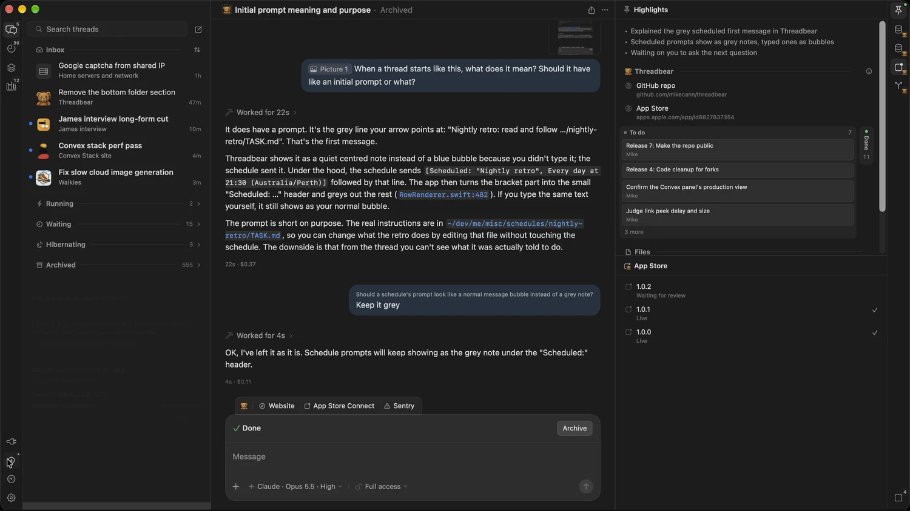
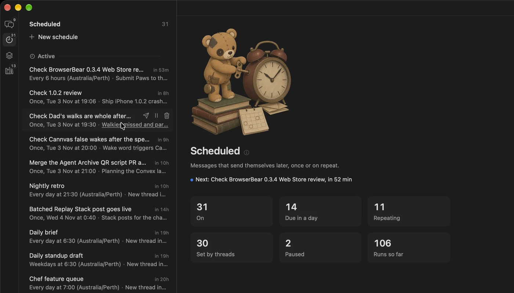
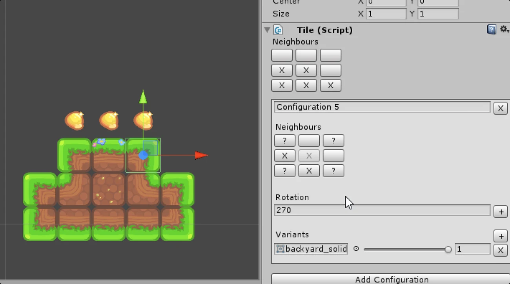
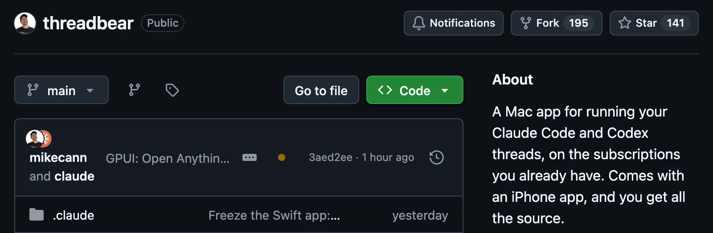
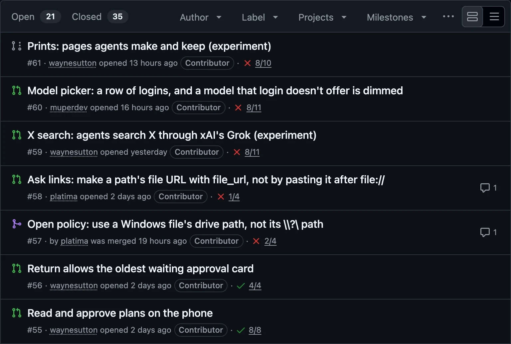

So a week or so ago I released an app called [Threadbear](https://threadbear.mikecann.app), which has totally taken over the way I work day to day. I made a whole video about it which goes through what it does if you are interested:

<iframe width="100%" height="400" src="https://www.youtube.com/embed/HCR6jqR0LEI" frameborder="0" allow="accelerometer; autoplay; clipboard-write; encrypted-media; gyroscope; picture-in-picture" allowfullscreen></iframe>

The TL;DW tho is that it's an ADE or Agentic Development Environment like Claude Desktop, Codex or T3 Code or one of the other million ones of these that are out there at the moment.

I was getting frustrated with how all those other tools work, there were micro annoyances in each so I decided to burn a few tokens one day and see if I could make my own. And to my great surprise it worked and I immediately fell in love with it.

It's built for me, to work exactly the way my brain works, but it turns out quite a few others wanted the same thing. The video has had over 10,000 views, the repo has been forked 195 times and 56 pull requests have come in from other people, which is kinda crazy for something that has only been public for 8 days and is still very much in development.

The thing I really wanted to write about though is what it has done to how I use my computer. I have [another little app](https://github.com/mikecann/remembear) that keeps track of what's on my screen, and when I checked it at the start of the month it said 57% of my time on the Mac was in Threadbear. I'm using it for much more than just coding, things like renewing my passport and designing a shed for my dad all go through a thread now.

# A normal day now

When I wake up in the morning I've got an inbox full of threads that finished overnight and are waiting for me. Each one tells me what it needs in a sentence or two with the answers as buttons, so I pick one, it goes off to carry on working and I'm on to the next thread.

<video autoplay loop muted playsinline style="width: 100%;">
  <source src="/posts/threadbear-has-taken-over-my-life/decision-card.mp4" type="video/mp4" />
</video>

That's pretty much my whole day now, making a decision and moving on to the next one. In the 18 days since I started on it there have been over 1,300 threads across 81 projects, some started by me and plenty started by a schedule or by another thread.

I'm making heavy use of the "scheduling" feature in Threadbear to remind me about this or check back on something in the future. For example every morning at 6:30 there's a brief of the day waiting for me, and on Mondays one checks whose birthday is coming up. There's also one that reminds me to book the room for [South West Devs](https://mikecann.blog/posts/south-west-devs-starting-a-tech-meetup-in-busselton) each month.

# Changing your own tools

As you probably know if you are reading this blog, most of my career has been in game development and I spent a lot of that time in Unity, where you're encouraged to change the editor yourself, adding your own little panels and menus to make your game easier to work on.

So now if I want a little tool or change I can just start a new thread and it happens, it's great. Before this I would have had to ask whoever makes the app and hope they agreed with me.

Like I said, I'm making liberal use of schedules. There's a schedule that runs every night and reads back over what I said that day, and when it notices me repeating myself or getting annoyed with something it kicks off a new thread to fix it. It's super meta, but it means some of the little annoyances get fixed without me even asking.

# It's not just me

Now I wanted everyone to have that same feeling of empowerment, taking control of your tooling like I had. So the way you install Threadbear is a bit different. You get your agent to fork the repo and build it for you. So everyone ends up with their own copy of the source that they can change however they like.

To get updates they just start a thread and it pulls in updates from my original version into their fork and applies my changes to whatever their version is up to.

It's been really cool seeing what people do with theirs. 56 pull requests have come in from 7 different people so far, including a mate of mine who got it going on Android and Windows, and one of my colleagues at Convex who has sent in 34 of them.

It's currently just a Mac app, but there's an [iPhone app](https://apps.apple.com/app/id6827837354) and as of this week [an Android one](https://github.com/mikecann/threadbear/releases/latest) too. I have heard from Linux and Windows users tho so I have a Rust + GPUI rewrite in the works at the moment.

From what I can see about 70 phones have been paired with a copy so far which is super cool! I'm particularly proud of the mobile experience, it's really really helpful and just feels great thanks to...

# Powered by Convex

None of the phone stuff would work without [Convex](https://convex.dev) (yes I work there so I would say that 😉).

<video autoplay loop muted playsinline style="width: 100%;">
  <source src="/posts/threadbear-has-taken-over-my-life/convex-sync.mp4" type="video/mp4" />
</video>

The deployment lives in your own Convex account and gets set up when you install, so I never see any of your threads.

I was a bit concerned about costs so I have tried hard to make it as efficient as possible. Only the text of the messages and a line for each thing the agent did goes up. Currently, even with how much I use it, that comes to only about US$1.50 a month of Convex usage.

I went into a lot more detail on how it all fits together in [the post on Stack](https://stack.convex.dev/threadbear).

# Conclusion

So that's where I'm at. Just about everything I do now goes through Threadbear and it has completely taken over the way I compute. It's incredible how being able to change your own tools whenever something bugs you just unlocks a whole nother level of productivity and enjoyment!

If you want to try it, it's all [on GitHub](https://github.com/mikecann/threadbear) and there are more pictures and an FAQ over at [threadbear.mikecann.app](https://threadbear.mikecann.app). If you do, I'd love to hear what you end up changing in yours!
